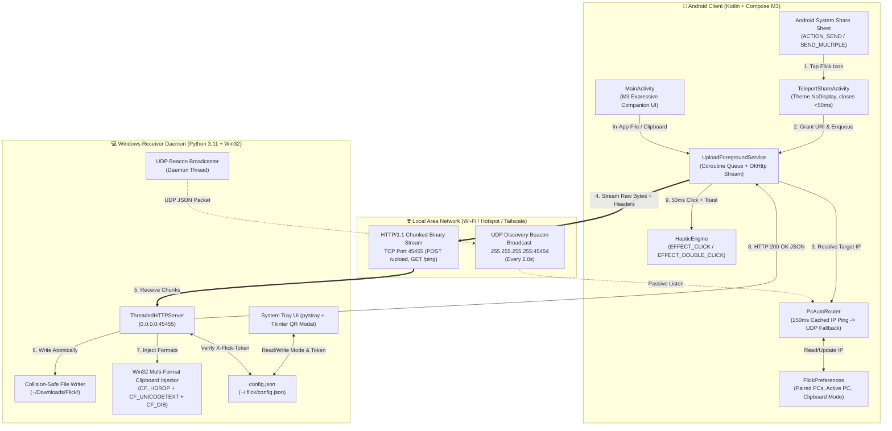
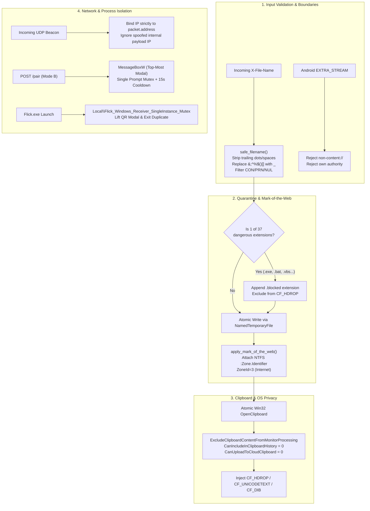
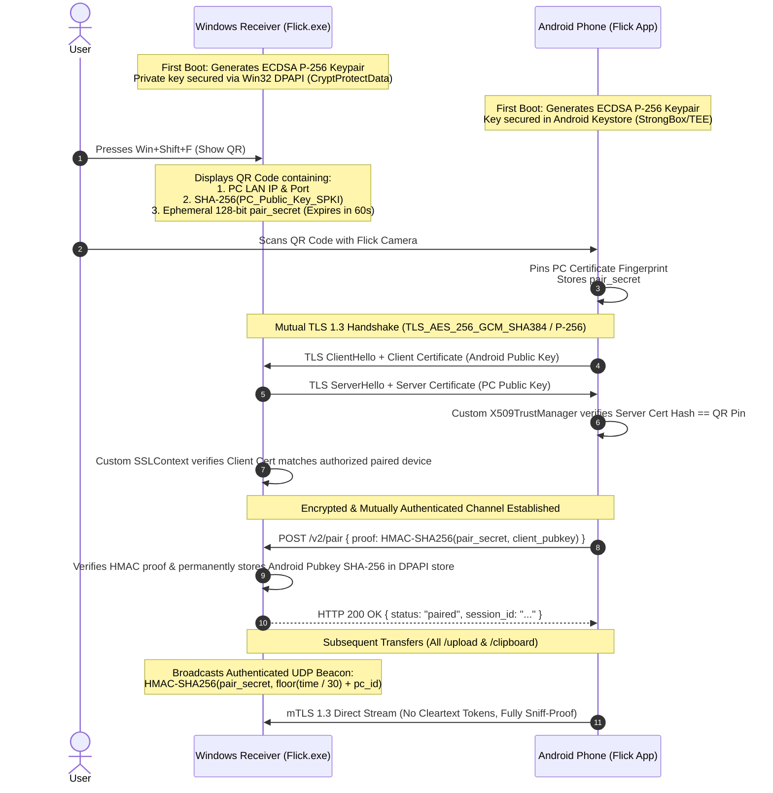

# 🏗️ Flick — System Architecture & Technical Contracts (`ARCHITECTURE.md`)

**Document Version:** 1.0.1  
**Target Workspace:** `D:\Sandbox\EkSend`  
**Audience:** Autonomous Engineering Agent (Gemini 3.8 Flash) & System Maintainers

---

## 1. High-Level System Architecture



---

## 2. Network Transport & Discovery Protocols

### 2.1 Port Allocation
| Protocol | Port | Direction | Purpose |
| :--- | :--- | :--- | :--- |
| **UDP** | `45454` | Windows $\rightarrow$ LAN Broadcast (`255.255.255.255` & subnet broadcast) | Zero-configuration IP discovery & DHCP drift recovery |
| **TCP (HTTP/1.1)** | `45455` | Android $\rightarrow$ Windows (`<pc_ip>:45455`) | Health check (`GET /ping`), Pairing (`POST /pair`), Streaming (`POST /upload`), Text (`POST /clipboard`) |

---

### 2.2 UDP Discovery Beacon Specification (Port `45454`)
The Windows Receiver runs a dedicated daemon thread (`UdpBeaconBroadcaster`) that broadcasts a UTF-8 JSON packet every **2.0 seconds** to both `255.255.255.255:45454` and the active interface's directed broadcast address.

#### Packet Schema (JSON):
```json
{
  "protocol": "FLICK_DISCOVERY_V1",
  "pc_id": "9b1deb4d-3b7d-4bad-9bdd-2b0d7b3dcb6d",
  "pc_name": "PARVEZ-WORKSTATION",
  "ip": "192.168.1.42",
  "http_port": 45455,
  "version": "1.0.0",
  "timestamp": 1730970000
}
```
- **Security Note:** The UDP beacon **never** broadcasts the `auth_token`. It only advertises the PC's presence, `pc_id`, `pc_name`, and current LAN `ip`.
- **Primary LAN IP Detection Rule on Windows:** Do not use `socket.gethostbyname(socket.gethostname())` alone, because WSL/Hyper-V/Docker virtual adapters (`172.x.x.x`) often take precedence. Instead, open a dummy UDP socket (`s.connect(("8.8.8.8", 80)); ip = s.getsockname()[0]`) to reliably determine the physical LAN interface IP, falling back to iterating `socket.getaddrinfo` for `192.168.*` / `10.*` addresses.

---

### 2.3 Multi-PC Auto-Routing & Fast-Path Resolution Algorithm
When `UploadService` on Android is triggered to send a payload to the active paired PC (`PairedPc` record containing `pcId`, `pcName`, `lastKnownIp`, `port`, `authToken`):

```
Step 1 (Fast Path — <150ms):
  Send HTTP GET http://{lastKnownIp}:{port}/ping
  with Header: X-Flick-Token: {authToken}
  Connect Timeout = 150ms, Read Timeout = 250ms.
  IF HTTP 200 OK and response.pc_id == pairedPc.pcId:
      RETURN lastKnownIp (Fast path succeeded in ~5-15ms!)

Step 2 (UDP Discovery Fallback — <= 2200ms):
  Open UDP socket bound to 0.0.0.0:45454 with SO_REUSEADDR and SO_TIMEOUT = 2200ms.
  Listen for incoming FLICK_DISCOVERY_V1 packets.
  WHEN packet received WHERE packet.pc_id == pairedPc.pcId:
      Update pairedPc.lastKnownIp = packet.ip in FlickPreferences.
      Verify HTTP GET http://{packet.ip}:{port}/ping (Connect Timeout = 300ms).
      IF HTTP 200 OK:
          RETURN packet.ip

Step 3 (Subnet Sweep Fallback — Optional Last Resort if UDP broadcast blocked by router AP isolation):
  Fail with clear error notification: "PC Offline or unreachable on Wi-Fi" + fire error haptic.
```

---

## 3. HTTP Streaming API Contract (Port `45455`)

All endpoints are served by a multi-threaded HTTP/1.1 server (`socketserver.ThreadingMixIn, http.server.HTTPServer`) on `0.0.0.0:45455`.

### 3.1 `GET /ping` — Health, Latency & Auth Verification
- **Request Headers:**
  - `X-Flick-Token`: `<shared_secret_token>` (Optional for unauthenticated discovery ping, required for `authenticated: true` status)
- **Response (`200 OK`, `application/json`):**
```json
{
  "status": "ok",
  "pc_id": "9b1deb4d-3b7d-4bad-9bdd-2b0d7b3dcb6d",
  "pc_name": "PARVEZ-WORKSTATION",
  "authenticated": true,
  "clipboard_mode": "SMART_MULTI",
  "version": "1.0.0"
}
```

### 3.2 `POST /pair` — Interactive LAN Pairing Handshake
Allows pairing either via QR code (instant, pre-shared token) or via KDE Connect-style 1-click LAN pairing request from the Home Dashboard.
- **Request Headers:** `Content-Type: application/json`
- **Request Body:**
```json
{
  "client_id": "android-pixel-8-uuid",
  "client_name": "Pixel 8 Pro",
  "pair_code": "C4C49136",
  "token": "<optional-if-scanned-from-qr>"
}
```
- **Behavior:**
  - If `token` matches the PC's `auth_token` (scanned via QR code), immediately registers the client in `config.json` `paired_devices` and returns `200 OK` with `{"status": "paired", "pc_id": "...", "pc_name": "...", "token": "..."}`.
  - If `token` is omitted (LAN discovery "Request Pair" button), the Windows Receiver pops up a native confirmation prompt (MessageBox / Tkinter top-most dialog) showing `"Allow pairing with Pixel 8 Pro (Code: C4C49136)?"`. If the user clicks **Yes** within 30 seconds, returns `200 OK` with the `auth_token`.

### 3.3 `POST /upload` — Zero-Copy Binary File Streaming & Clipboard Injection
Streams a single file (or sequential files in a multi-file share) directly to disk and injects it into the Windows Clipboard.
- **Request Headers:**
  - `X-Flick-Token`: `<32-byte-hex-secret>` (**Mandatory** — returns `401 Unauthorized` if invalid)
  - `X-File-Name`: URL-encoded UTF-8 original filename (e.g., `Screenshot_20261107-153012.png`)
  - `X-Mime-Type`: MIME type from Android `ContentResolver` (e.g., `image/png`, `video/mp4`, `application/pdf`)
  - `X-Clipboard-Mode`: `DEFAULT` | `SMART_MULTI` | `FORCE_IMAGE` | `FORCE_PATH` | `FORCE_FILE` (If `DEFAULT`, uses the Windows Tray's currently selected mode; otherwise overrides it for this transfer)
  - `X-Batch-Index`: `0` (0-based index when uploading multiple files in `ACTION_SEND_MULTIPLE`)
  - `X-Batch-Total`: `1` (Total files in current share operation)
  - `Content-Length`: `<byte_size>` (Or `Transfer-Encoding: chunked` if stream length is unknown)
- **Request Body:** Raw binary stream of the file (`application/octet-stream`). **Do NOT use `multipart/form-data`**, as multipart encoding adds boundary parsing overhead and memory buffering in Python's standard library. Raw binary body streaming reads `65536`-byte chunks directly from `self.rfile` to the file descriptor.
- **Response (`200 OK`, `application/json`):**
```json
{
  "status": "ok",
  "saved_path": "C:\\Users\\Parvez\\Downloads\\Flick\\Screenshot_20261107-153012.png",
  "bytes_written": 1458291,
  "clipboard_formats": ["CF_HDROP", "CF_UNICODETEXT", "CF_DIB"],
  "elapsed_ms": 84
}
```

### 3.4 `POST /clipboard` — Instant Text / URL Teleport
Pushes plain text or URLs shared via `ACTION_SEND` (`text/plain`) or via the in-app "Clipboard" button directly to the Windows text clipboard without creating a file on disk.
- **Request Headers:**
  - `X-Flick-Token`: `<32-byte-hex-secret>`
  - `Content-Type`: `text/plain; charset=utf-8`
- **Request Body:** UTF-8 text payload.
- **Response (`200 OK`, `application/json`):**
```json
{
  "status": "ok",
  "characters_copied": 128,
  "clipboard_formats": ["CF_UNICODETEXT"]
}
```

---

## 4. Win32 Multi-Format Clipboard Engine (`clipboard_engine.py`)

This is the crown jewel of Flick's desktop integration. Windows allows a single clipboard transaction (`OpenClipboard` $\rightarrow$ `EmptyClipboard` $\rightarrow$ multiple `SetClipboardData` calls $\rightarrow$ `CloseClipboard`) to hold **multiple formats simultaneously**. Target applications automatically query the format they prefer when the user presses `Ctrl + V`.

### 4.1 Supported Clipboard Modes

| Mode ID | Injected Win32 Formats | Behavior When Pressing `Ctrl + V` |
| :--- | :--- | :--- |
| **`SMART_MULTI`** *(Default)* | **1.** `CF_HDROP` (all files)<br>**2.** `CF_UNICODETEXT` (absolute path(s))<br>**3.** `CF_DIB` (if single image $\le 32\text{ MB}$) | • **Antigravity / Cursor / VS Code / Chrome / Discord / Explorer:** Pastes/uploads the actual file or image!<br>• **Windows Terminal / PowerShell / Notepad:** Pastes the exact file path string!<br>• **MS Paint / Image Editors:** Pastes raw bitmap pixels! |
| **`FORCE_PATH`** | `CF_UNICODETEXT` only | Forces **all** apps (even rich text editors, browsers, and chat boxes) to paste the plain text file path `"C:\Users\...\file.ext"`. |
| **`FORCE_IMAGE`** | `CF_DIB` + `CF_HDROP` (no text path) | Forces apps that prioritize text over images to paste the visual image instead of the file path. |
| **`FORCE_FILE`** | `CF_HDROP` only | Behaves identically to pressing `Ctrl + C` on a file in Windows File Explorer. |

### 4.2 Exact Binary Structure for `CF_HDROP` (`DROPFILES` Struct)
To inject `CF_HDROP` via `win32clipboard.SetClipboardData(win32con.CF_HDROP, data)`, the byte buffer must begin with a 20-byte C `DROPFILES` header followed by a double-null-terminated UTF-16LE string list of absolute file paths:

```python
import struct
import win32clipboard
import win32con

def build_cf_hdrop_payload(file_paths: list[str]) -> bytes:
    """
    Constructs a valid Win32 DROPFILES structure in UTF-16LE (Unicode) mode:
    typedef struct _DROPFILES {
        DWORD pFiles; // Offset of file list from start of struct (20 bytes)
        POINT pt;     // Drop point (0, 0) -> 8 bytes
        BOOL  fNC;    // Non-client area flag (0) -> 4 bytes
        BOOL  fWide;  // TRUE (1) for UTF-16LE Unicode strings -> 4 bytes
    } DROPFILES;
    Total header = 20 bytes ("<IiiII").
    Followed by each path encoded in UTF-16LE + b"\\x00\\x00",
    terminated by a final b"\\x00\\x00".
    """
    header = struct.pack("<IiiII", 20, 0, 0, 0, 1)
    encoded_paths = b"".join(os.path.abspath(p).encode("utf-16le") + b"\x00\x00" for p in file_paths)
    return header + encoded_paths + b"\x00\x00"
```

### 4.3 Exact Binary Structure for `CF_DIB` (Device-Independent Bitmap)
When the uploaded file is an image (`.png`, `.jpg`, `.jpeg`, `.webp`, `.bmp`, `.gif`):
1. Open the saved image via Pillow (`PIL.Image.open(path)`).
2. Handle EXIF orientation (`ImageOps.exif_transpose(img)`) so portrait phone photos are never rotated sideways when pasted as bitmaps!
3. Convert to RGB (`img.convert("RGB")`).
4. Save to an in-memory `io.BytesIO` buffer in `"BMP"` format.
5. **Strip the first 14 bytes** (the `BITMAPFILEHEADER`), because `win32con.CF_DIB` requires the buffer to start immediately at the `BITMAPINFOHEADER` (`byte[14:]`).

```python
import io
from PIL import Image, ImageOps

def build_cf_dib_payload(image_path: str) -> bytes:
    with Image.open(image_path) as img:
        img = ImageOps.exif_transpose(img)
        if img.mode != "RGB":
            # Composite alpha over white background for 24-bit BMP compatibility
            bg = Image.new("RGB", img.size, (255, 255, 255))
            if "A" in img.getbands():
                bg.paste(img, mask=img.split()[-1])
                img = bg
            else:
                img = img.convert("RGB")
        buf = io.BytesIO()
        img.save(buf, format="BMP")
        return buf.getvalue()[14:]  # Strip 14-byte BITMAPFILEHEADER
```

### 4.4 Clipboard Contention & Thread-Safety Contract
In Windows, `OpenClipboard(0)` fails with `pywintypes.error: (5, 'OpenClipboard', 'Access is denied.')` if another process (such as Windows Clipboard History `win+v` or an IDE) is currently inspecting the clipboard.
- All clipboard writes **must** acquire a process-wide `threading.Lock()` and execute a retry loop up to `10` times with `time.sleep(0.025)` (`25ms`) between attempts:
```python
for attempt in range(10):
    try:
        win32clipboard.OpenClipboard(0)
        break
    except Exception:
        if attempt == 9:
            raise
        time.sleep(0.025)
try:
    win32clipboard.EmptyClipboard()
    # Inject formats according to active mode...
finally:
    win32clipboard.CloseClipboard()
```

---

## 5. Multi-File Share Batching (`ACTION_SEND_MULTIPLE`)
When a user shares multiple files at once from Android:
- `TeleportShareActivity` extracts the `ArrayList<Uri>` via `IntentCompat.getParcelableArrayListExtra(intent, Intent.EXTRA_STREAM, Uri::class.java)`.
- Each URI is uploaded sequentially in the same batch with `X-Batch-Index: i` and `X-Batch-Total: N`.
- The Windows Receiver collects all saved paths for the batch (or updates the clipboard cumulatively) so when `X-Batch-Index == X-Batch-Total - 1`, `CF_HDROP` contains **all `N` files** in the `DROPFILES` struct, and `CF_UNICODETEXT` contains all `N` paths separated by `\r\n`.

---

## 6. Persistent Storage Schemas

### 6.1 Windows Configuration (`~/.flick/config.json`)
```json
{
  "pc_id": "9b1deb4d-3b7d-4bad-9bdd-2b0d7b3dcb6d",
  "pc_name": "PARVEZ-PC",
  "http_port": 45455,
  "udp_port": 45454,
  "auth_token": "8f4b2e91c7a04d56b3e192837465fa0192837465fa018f4b2e91c7a04d56b3e1",
  "save_directory": "C:\\Users\\Parvez\\Downloads\\Flick",
  "clipboard_mode": "SMART_MULTI",
  "play_sound": true,
  "paired_devices": [
    {
      "client_id": "a1b2c3d4-e5f6-4789-abcd-1234567890ab",
      "client_name": "Pixel 8 Pro",
      "paired_at": 1730970000
    }
  ]
}
```

### 6.2 Android Preferences (`SharedPreferences` / `FlickPreferences.kt`)
Stored in `context.getSharedPreferences("flick_prefs", Context.MODE_PRIVATE)`:
- `client_id` (`String`): Auto-generated UUID on first install.
- `client_name` (`String`): `Build.MANUFACTURER + " " + Build.MODEL`.
- `active_pc_id` (`String?`): ID of the currently targeted PC for 1-Tap Share.
- `paired_pcs_json` (`String`): JSON array of paired PCs:
  ```json
  [
    {
      "pcId": "9b1deb4d-3b7d-4bad-9bdd-2b0d7b3dcb6d",
      "pcName": "PARVEZ-PC",
      "lastKnownIp": "192.168.1.42",
      "port": 45455,
      "authToken": "8f4b2e91c7a04d56b3e192837465fa0192837465fa018f4b2e91c7a04d56b3e1",
      "lastSeenEpochMs": 1730970000000
    }
  ]
  ```
- `clipboard_mode_override` (`String`): `"DEFAULT"` | `"SMART_MULTI"` | `"FORCE_IMAGE"` | `"FORCE_PATH"` | `"FORCE_FILE"`.
- `haptic_feedback_enabled` (`Boolean`): `true` by default.
- `recent_transfers_json` (`String`): Ring buffer of the last 20 transfers (`fileName`, `mimeType`, `bytes`, `status`, `elapsedMs`, `timestamp`) for instant display on the Home Dashboard.

---

## 7. Security Hardening & Local Threat Mitigation (v1.0.1 Implemented)

Following an adversarial threat audit, the following defense-in-depth mitigations were applied across Windows and Android:



### 7.1 Filename-to-Terminal Command Injection Defense (`safe_filename`)
- **Vulnerability:** Pasting paths containing shell metacharacters (`&`, `;`, `^`, `%`, `$`, `(`, `)`) into `cmd.exe` or PowerShell causes immediate arbitrary command execution. Win32 file creation also strips trailing dots and spaces, allowing denylist bypasses (e.g. `malware.exe.` becomes `malware.exe`).
- **Mitigation:**
  - Trailing dots and spaces are stripped first.
  - Characters `&;^%$()[]` are sanitized to `_`.
  - Windows reserved DOS names (`CON`, `PRN`, `AUX`, `NUL`, `COM1-9`, `LPT1-9`) are prefixed with `_`.
  - Extension is extracted only after trailing character stripping.

### 7.2 Extension Quarantine & NTFS Mark-of-the-Web (ZoneId=3)
- **Vulnerability:** Untrusted downloads landing in user directories can be executed directly or trigger SMB/NTLM authentication via Explorer preview handlers (`.url`, `.scf`, `.library-ms`).
- **Mitigation:**
  - 37 high-risk executable, script, and shortcut extensions (`.exe`, `.bat`, `.cmd`, `.vbs`, `.ps1`, `.msi`, `.reg`, `.lnk`, `.url`, `.iso`, etc.) have `.blocked` appended to their on-disk filename.
  - Quarantined files are completely omitted from `CF_HDROP` clipboard injection (preventing accidental file pastes/launches).
  - All written files receive an alternate data stream: `path:Zone.Identifier` containing `[ZoneTransfer]\nZoneId=3\nHostUrl=http://flick.local`, triggering Windows SmartScreen and warning flags if manually renamed.

### 7.3 Windows 10/11 Clipboard History (`Win+V`) & Cloud Sync Opt-Out
- **Vulnerability:** Sensitive texts, URLs, and clipboard content shared via Flick are automatically captured by Windows Clipboard History and synced to Microsoft cloud servers if clipboard sync is enabled.
- **Mitigation:**
  - Before injecting data, `clipboard_engine.py` registers and sets Win32 clipboard format flags:
    - `ExcludeClipboardContentFromMonitorProcessing`
    - `CanIncludeInClipboardHistory` (DWORD 0)
    - `CanUploadToCloudClipboard` (DWORD 0)
  - This guarantees sensitive clipboard transfers remain transient in local memory only.

### 7.4 Beacon IP Spoofing Neutralization
- **Vulnerability:** Attackers on the LAN broadcasting fake discovery beacons could claim victim PC IDs with their own attacker IP, causing the Android app to redirect file streams and auth tokens.
- **Mitigation:** `UdpDiscoveryListener.kt` ignores the self-reported `packet.ip` and binds `effectiveIp` directly to `packet.address.hostAddress` from the UDP socket packet layer.

### 7.5 Process Single-Instance Mutex & Pre-Auth DoS Controls
- Win32 Named Mutex `Local\Flick_Windows_Receiver_SingleInstance_Mutex` enforces a single running receiver daemon. Secondary launches focus the existing QR modal and cleanly exit.
- `Content-Length` caps: `/pair` is limited to 64 KB; `/clipboard` is limited to 256 KB; `/upload` requires a minimum 500 MB free disk space buffer and caps files at 4 GB.
- CSRF protection: Rejects requests containing an `Origin` header.

---

## 8. v2.0 Zero-Trust Mutual TLS 1.3 (mTLS) Specification

To eliminate the static bearer token and prevent network sniffing on untrusted Wi-Fi (airports, coffee shops), Flick v2.0 upgrades the transport layer to **Zero-Trust Mutual TLS 1.3 with P-256 Public Key Pinning**.



### 8.1 Key Pair Management & Cryptographic Storage
1. **Windows Receiver:**
   - Generates an ECDSA keypair using curve `secp256r1` (NIST P-256) and a self-signed X.509 certificate valid for 10 years (`CN=Flick-PC-<UUID>`).
   - Private key is encrypted on disk at `~/.flick/pc_key.enc` using Windows DPAPI (`CryptProtectData`), tied to the Windows user account login credential.
2. **Android Client:**
   - Generates an ECDSA P-256 keypair in the hardware-backed **Android Keystore** (`AndroidKeyStore`), utilizing `KeyProperties.PURPOSE_SIGN | KeyProperties.PURPOSE_VERIFY`.
   - On devices supporting StrongBox Keymaster (Pixel 3+, Galaxy S20+), sets `setIsStrongBoxBacked(true)` for tamper-proof hardware enclave protection.

### 8.2 Out-of-Band QR Pairing Handshake
The QR code payload is upgraded to a compact JSON or URI schema:
```text
flick://pair?v=2&ip=192.168.1.42&p=45455&pin=a3b8...64hex...&s=9f2c...32hex...&id=9b1deb4d...
```
- `pin`: `SHA-256(PC_DER_Certificate)` (Hex string, 64 chars).
- `s`: 128-bit single-use ephemeral pairing secret (`pair_secret`).
- The Android app configures an OkHttp `CertificatePinner` / custom `X509TrustManager` accepting only certificates whose SHA-256 SPKI fingerprint matches `pin`.
- The connection is established directly over HTTPS (`https://192.168.1.42:45455`).
- Android sends proof of possession: `HMAC-SHA256(pair_secret, Android_Cert_DER)` over the TLS channel.
- Upon successful verification, PC registers the Android Certificate Fingerprint into its trusted devices list.

### 8.3 Authenticated UDP Beacons (Anti-Replay & Anti-Spoofing)
- Beacons on UDP `45454` include a rolling authenticator tag:
  $$\text{AuthTag} = \text{HMAC-SHA256}_{pair\_secret}\left(\lfloor \text{EpochTime} / 30 \rfloor \parallel pc\_id\right)$$
- The Android app verifies the authenticator against the stored `pair_secret` with a $\pm 1$ time-step window (90-second replay grace period).
- Rogue beacons broadcast by malicious LAN actors are silently discarded without waking the network stack or triggering HTTP requests.


