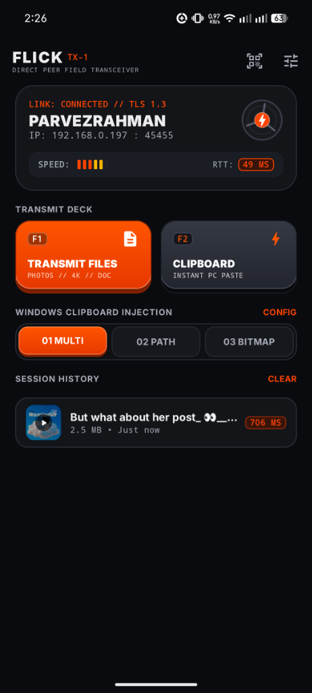
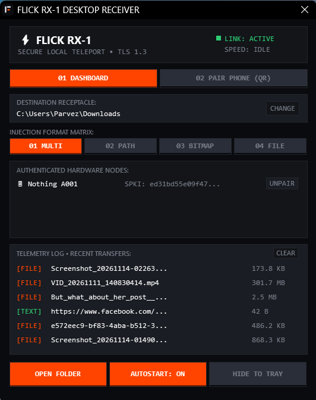
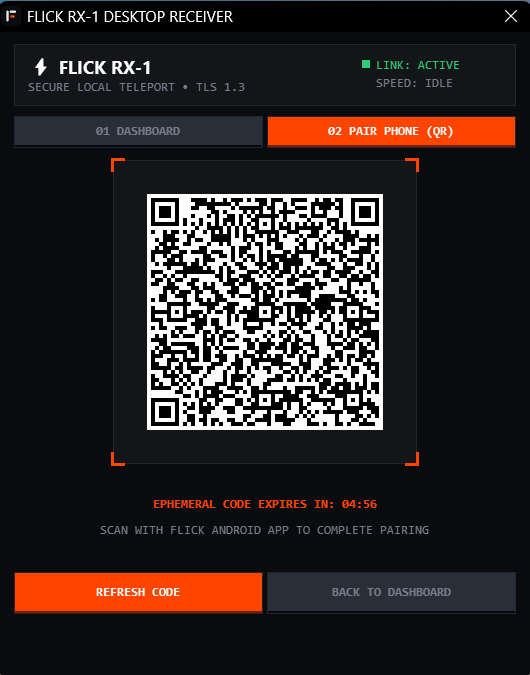

<div align="center">

# ⚡ Flick

**Fast, tactile phone-to-PC file & clipboard sharing over local Wi-Fi.**  
*Send photos, files, or text from Android — press `Ctrl + V` on Windows.*

<p>
  
  
  
  
  
  
</p>

<p>
  <a href="#-screenshots">Screenshots</a> •
  <a href="#-features">Features</a> •
  <a href="#-how-to-pair">Pairing</a> •
  <a href="#-how-to-use">How to Use</a> •
  <a href="#-paste-modes">Paste Modes</a> •
  <a href="#-build-from-source">Build</a>
</p>

</div>

---

## ✨ Why Flick?

Flick lets you move files, images, links, and text from your Android phone straight into your Windows clipboard over local Wi-Fi — no cables, no cloud uploads, and no messaging yourself.

Both apps share a matching hardware-inspired dark interface (**`TX-1`** on Android and **`RX-1`** on Windows), while still letting you send anything in one tap right from the Android Share Sheet.

---

## 📸 Screenshots

<div align="center">

| **Android Companion (`TX-1`)** | **Windows Receiver (`RX-1`)** | **Ephemeral QR Pairing** |
| :---: | :---: | :---: |
|  |  |  |
| Live link telemetry, `F1`/`F2` transmit keys, clipboard mode rocker & transfer history | Native Rust Win32 dashboard, destination folder, mode matrix & transfer log | 5-minute expiring QR code for instant encrypted pairing |

</div>

---

## 🚀 Features

- **Instant `Ctrl + V` Clipboard Injection** — Incoming files, images, and text are copied straight to your Windows clipboard the moment they finish transferring.
- **Multi-File Batch Paste & `Win + V` Image Stacking** — Share multiple photos or files at once: press `Ctrl + V` to paste all files together (Explorer, Discord, WhatsApp, browsers), or press `Win + V` to paste individual image thumbnails one by one in single-image inputs.
- **Matching Phone & PC Dashboards** — Tactile `TX-1` Android app (Jetpack Compose) and ultra-light `RX-1` Windows app (pure Rust, ~2 MB binary, ~3.4 MB RAM).
- **1-Tap Android Share Sheet** — Share photos, videos, documents, or text directly from any app via **Share → Flick**.
- **Smart Clipboard Modes** — Choose whether `Ctrl + V` pastes a file, an image bitmap, a local file path, or all of them together.
- **Auto-Discovery & System Tray** — Runs quietly in the Windows tray with optional autostart and automatic LAN IP rediscovery.
- **End-to-End Encrypted on LAN** — Paired devices communicate over Mutual TLS 1.3 with certificate pinning — no static passwords or cloud servers involved.

---

## 🔗 How to Pair

1. **Open Flick on Windows** — Launch `Flick.exe` (or open it from the system tray) and click the **`02 PAIR PHONE (QR)`** tab.
2. **Open Flick on Android** — Tap the **QR Scanner** icon in the top-right corner of **`FLICK TX-1`**.
3. **Scan the Code** — Point your phone camera at the QR code on your PC (valid for 5 minutes). Both devices exchange keys and connect automatically.

> Once paired, your phone and PC remember each other and reconnect automatically whenever both are on the same Wi-Fi network.

---

## 📱 How to Use

### Method 1 — From Any App (Share Sheet)
1. Select any photo, video, file, or text on your phone.
2. Tap **Share → Flick**.
3. Wait for the quick haptic buzz (and PC chime), then press **`Ctrl + V`** on Windows.

### Method 2 — From the Flick App (`TX-1`)
- **`F1 TRANSMIT FILES`** — Pick one or multiple photos, videos, or documents from your phone to send in a batch.
- **`F2 CLIPBOARD`** — Grab text or a URL from your phone clipboard (or type one) and push it straight to your PC clipboard.
- **Mode Rocker (`01 MULTI` / `02 PATH` / `03 BITMAP`)** — Quickly change how the next transfer pastes on Windows.

> **Multi-Image Tip:** When sending multiple images at once (or back-to-back), Flick automatically stacks each image into Windows Clipboard History (`Win + V`) while keeping the full multi-file batch ready for `Ctrl + V`. You can toggle this anytime from the system tray (**`Stack Images in Win+V History`**).

---

## 📋 Paste Modes

Switch modes anytime from the **`TX-1`** app or the **`RX-1`** desktop dashboard:

| Mode | What `Ctrl + V` Pastes | Best Used In |
| :--- | :--- | :--- |
| **`01 MULTI`** *(Default)* | File + File Path + Image Bitmap | Everyday pasting — works in Explorer, browsers, Discord, chat apps, and terminals |
| **`02 PATH`** | Local file path text (`C:\Users\...\image.png`) | PowerShell, CMD, VS Code, or scripts |
| **`03 BITMAP`** | Uncompressed image pixels | Paint, Figma, Photoshop, and image editors |
| **`04 FILE`** | Windows file drop (`CF_HDROP`) | File Explorer, upload dialogs, and desktop messengers |

---

## 🔒 Security

- **Mutual TLS 1.3:** Both phone and PC authenticate each other using ECDSA P-256 certificates pinned during QR pairing.
- **Hardware / OS Key Protection:** Keys are stored in `AndroidKeyStore` on Android and encrypted with Windows DPAPI on PC.
- **Safe File Handling:** Filenames are sanitized, incoming files are marked with NTFS `Zone.Identifier`, and risky executable extensions are quarantined with `.blocked`.
- **Clipboard Privacy:** Sensitive clipboard items opt out of Windows `Win + V` history and Cloud Clipboard sync.

---

## 🛠 Tech Stack

<p>
  
  
  
  
  
  
  
</p>

---

## 📦 Build from Source

### Windows Receiver (`windows-receiver-rust`)
Requires Rust (`x86_64-pc-windows-msvc` target):

```powershell
cd windows-receiver-rust
cargo build --release
```

Built binary: `windows-receiver-rust\target\release\flick.exe`  
Default download folder: `%USERPROFILE%\Downloads\Flick`

### Android App (`android-app`)
Requires Android Studio or JDK 17 + Android SDK (API 35):

```powershell
cd android-app
.\gradlew assembleDebug
```

Built APK: `android-app\app\build\outputs\apk\debug\app-debug.apk`

---

## 📁 Project Structure

```text
.
├── android-app/              # FLICK TX-1 Android app (Kotlin + Jetpack Compose)
├── windows-receiver-rust/    # FLICK RX-1 Windows receiver (Rust + Win32)
├── windows-receiver/         # Legacy Python receiver (reference)
├── installer/                # Windows installation scripts
└── docs/                     # Screenshots & specification index (docs/SPEC_INDEX.md)
```

---

## 🗺 Roadmap

- [x] **Multi-File Batch Paste & `Win + V` Image Stacking:** Batch multiple shared images/files via `CF_HDROP` (`Ctrl + V`) and stack individual `CF_DIB` thumbnails in Windows `Win + V` history
- [ ] **Two-Way Sync (`PC → Phone`):** Send text and files from Windows back to Android
- [ ] **Android Direct Share:** Pin paired PCs to the top row of the Android Share Sheet
- [ ] **Cross-Subnet Discovery:** mDNS & Tailscale support alongside local UDP discovery
